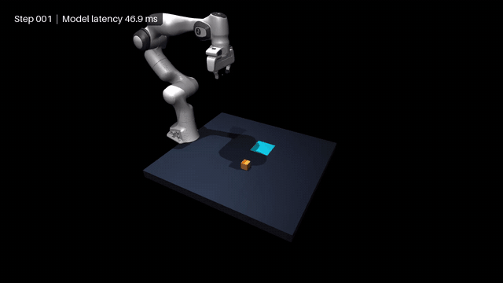
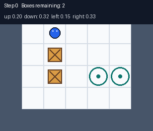
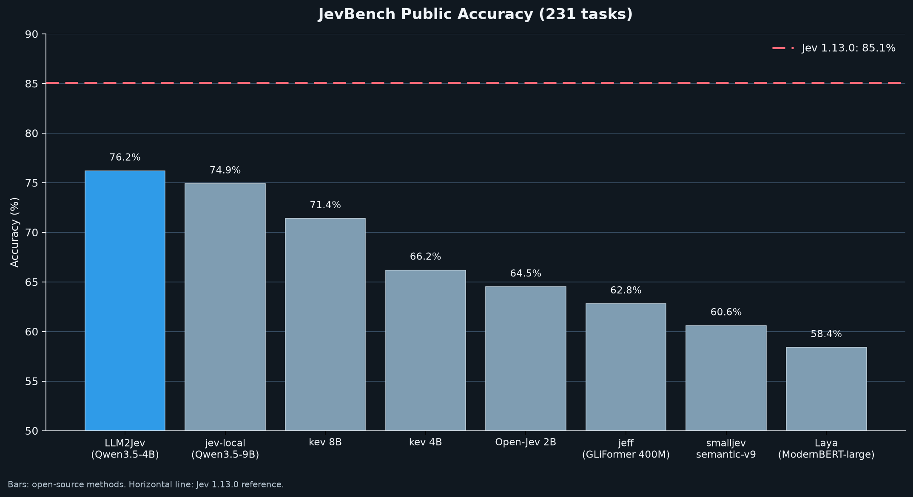

  <p align="center">
    
  </p>

<div align="center">

# 🧠 LLM2Jev: Give Your LLM / MLLM a Decision Engine
<br/>

[](pyproject.toml)
[](LICENSE)
[](docs/en/usage.md)
[](docs/en/usage.md)

[Project website](https://yinsongxu.github.io/LLM2Jev/) · [简体中文](README_zh.md)

**Turn your LLM / MLLM into a Jev-style decision model. Zero training required.**

Put your existing model weights to work on classification, scoring, and action selection from text and images. Get decision probabilities with prefill alone, across SGLang, Transformers, and MLX backends. Call decisions and chat through the same client, built on the OpenAI Python SDK, wherever the serving backend supports both.

</div>

> LLM2Jev is an independent open-source project. It is not affiliated with or endorsed by Jev or TypeSafe.


## 📰 News

- **October 15** - **[Box localization](docs/en/multimodal.md#box-locate-a-target-in-an-image):** locate image targets with Qwen3.5's normalized 0–1000 coordinates.
- **October 11** - **[v0.1.0](docs/en/releases/v0.1.0.md):** give your LLM / MLLM Jev-style decision capabilities with zero training. Supports SGLang, Transformers, and MLX, with a Python client that extends the OpenAI SDK.
- **October 8** - **[Valen Sokoban evaluation](examples/valen_sokoban.py):** added a visual Sokoban demo and single-step action evaluation based on [Valen](https://github.com/Liuziyu77/Valen).

<details>
<summary>Earlier updates</summary>

- **September 26** - **[JevBench evaluation](docs/en/jevbench.md):** LLM2Jev accuracy and latency on 231 public items; P50 latency is below one tenth of the Jev official result.
- **September 23** - **[MLX backend](docs/en/usage.md#offline-python-api):** added text and image scoring, candidate batching, bounded prefix reuse, and a compatible System One HTTP service.
- **September 22** - **[Multimodal inputs](docs/en/multimodal.md):** added text-and-image requests for SGLang, Transformers, and the System One HTTP API.
- **September 21** - **[Web and Snake demos](#demos):** added interactive examples for composing mixed questions and model-driven decisions.
- **September 21** - **Prefix reuse on cold requests:** added staged candidate submission for reusing SGLang's Radix Cache, with [architecture](docs/en/request-to-model.md), [usage](docs/en/shared-prefix-cache.md), and [benchmark](docs/en/shared-prefix-benchmarks.md) documentation.
- **September 20** - **SGLang and System One API:** added the SGLang scoring backend and a compatible [`POST /v1/systemone`](docs/en/usage.md#online-http-service) endpoint.

</details>

## ✨ Key Features

- **No training or fine-tuning:** use existing model weights to make Jev-style decisions with models supported by SGLang, Transformers, or MLX on Apple Silicon.
- **Chat and decisions share a service and model:** with the SGLang backend, chat and `/v1/systemone` use the same inference engine and loaded model.
- **Chat and decisions share a client:** `Client` and `AsyncClient` extend the OpenAI Python SDK with `systemone.create()`, preserving its existing interfaces, authentication, timeouts, and retries. Endpoint availability depends on the backend.
- **Prefill only:** read yes/no logits and assemble probabilities directly, without generating an answer or parsing generated JSON.
- **Text and image decisions:** combine text and images in `state` or `instructions` for classification, evaluation, and action selection.
- **Three question types in one request:** mix `Choice`, `Score`, and `Noul` to get option probabilities, rubric scores, and yes/no probabilities as typed Python objects or JSON.
- **Reuse shared prefixes:** reduce repeated computation across candidates with SGLang's Radix Cache or MLX's explicit prefix prefill, including within a cold request.

Candidates share `state`, and candidates for the same question also share its `instructions`. The SGLang backend first scores a real `criteria` candidate to establish the prefix cache, then submits candidates that can reuse it. Each candidate is scored once, reducing repeated computation for long inputs with many candidates. The MLX backend explicitly prefills shared prefixes before scoring candidate suffixes.


Both backends preserve the same binary scoring interface. See the [Usage guide](docs/en/usage.md) for details.

Learn how it works: [From Jev Request to LLM Request](docs/en/request-to-model.md) → [Shared-prefix design](docs/en/shared-prefix-cache.md).

## 🚀 Quick Start

On Linux with a supported NVIDIA GPU, start one SGLang service for chat and decisions:

```bash
git clone https://github.com/Yinsongxu/LLM2Jev.git
cd LLM2Jev
uv sync --extra sglang
source .venv/bin/activate
llm2jev-serve --backend sglang --model-path /path/to/model \
  --served-model-name local-model --host 127.0.0.1 --port 30000
```

Replace `/path/to/model` with a model directory supported by SGLang. In another terminal, use the same Python environment to call both endpoints with one client:

```python
from llm2jev import Client, Choice

client = Client(base_url="http://localhost:30000/v1", api_key="unused")

decision = client.systemone.create(
    model="local-model",
    state="My card was charged twice.",
    questions={"department": Choice(criteria={
        "billing": "Charges and billing", "shipping": "Delivery",
    })},
)
print(decision.choices["department"].probabilities)

chat = client.chat.completions.create(
    model="local-model",
    messages=[{"role": "user", "content": "How can I request a refund?"}],
)
print(chat.choices[0].message.content)
```

Use your service's API key if authentication is enabled. See the [Usage guide](docs/en/usage.md) for async calls, client lifecycle, offline inference, and the MLX and Transformers services. For image serving, see [Multimodal inputs](docs/en/multimodal.md).

## 📦 Installation

See [Installation](docs/en/installation.md) for environment requirements, SGLang, Transformers, and MLX dependencies, and uv or pip installation.

## 📖 Getting Started

See the [Usage guide](docs/en/usage.md) for complete examples:

- [Offline: Python API](docs/en/usage.md#offline-python-api)
- [Online: HTTP service](docs/en/usage.md#online-http-service)
- [Online: Python client](docs/en/usage.md#python-client)
- [Choosing between `staged` and `all`](docs/en/usage.md#choosing-between-staged-and-all)
- [Multimodal inputs](docs/en/multimodal.md)

<a id="demos"></a>

## 🎮 Demos

<table>
  <tr>
    <td align="center" valign="middle" width="67%"></td>
    <td align="center" valign="middle" width="33%"></td>
  </tr>
  <tr>
    <td align="center"><a href="demos/web/README.md"><strong>Web demo</strong></a></td>
    <td align="center"><a href="demos/snake.py"><strong>Snake demo</strong></a></td>
  </tr>
  <tr>
    <td align="center" valign="middle"><br><a href="demos/pick_place/README.md"><strong>MuJoCo pick-and-place demo</strong></a></td>
    <td align="center" valign="middle"><br><a href="examples/valen_sokoban.py"><strong>Valen Sokoban demo</strong></a></td>
  </tr>
</table>


## 📊 Benchmarks

See [Performance benchmarks](docs/en/shared-prefix-benchmarks.md) for the Qwen3-1.7B / RTX 5090 measurements, test conditions, and comparison of `staged` and `all` across cold and warm caches. Gains depend on input length, candidate count, and cache state.

### JevBench public accuracy

This test covers 231 public JevBench items. LLM2Jev with Qwen3.5-4B measured **76.2%** accuracy.



The recorded LLM2Jev latency is **P50 48 ms / P95 346 ms**, while the Jev 1.13.0 values are **P50 652 ms / P95 722 ms**. See the [JevBench report](docs/en/jevbench.md) for the data and reproduction commands.

### Valen-Eval-Game

The [single-step evaluator](examples/valen_sokoban_single_step.py) measures tie-aware optimal-action accuracy on 500 image-conditioned Sokoban questions from [Valen](https://github.com/Liuziyu77/Valen). It uses the multimodal `Choice` pipeline with the SGLang backend.

## 🗺️ Roadmap

- [ ] More benchmarks across model sizes, datasets, and workloads, covering decision quality, latency, and throughput.
- [x] An interactive web demo for submitting questions and inspecting probabilities.
- [x] Initial local-image support for Transformers and SGLang.
- [x]  More multimodal tasks and demos.

## 🧪 Tests

```bash
python -m unittest discover -s tests -v
```

## 📄 License

This project is licensed under the [Apache License 2.0](LICENSE).
